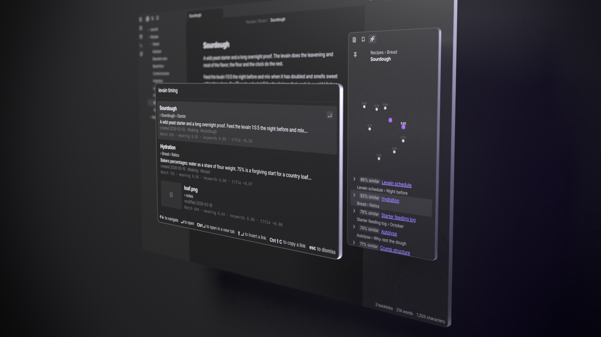

# Gnosis for Obsidian



Search your vault with [gnosis](https://github.com/ptsouchlos/gnosis)'s own
retrieval pipeline, reading a portable index you built on your own machine.
No server, no API key, nothing leaves the vault.

**Desktop only.** The models run in a worker with WebAssembly or WebGPU, and
their downloads run to hundreds of megabytes, which this plugin does not ask of
a phone. Obsidian does not offer it on mobile.

The ranking code is not reimplemented here. gnosis's query pipeline is
compiled to WebAssembly and vendored in `vendor/gnosis-wasm/`, so the lexical
channel, BM25+'s parameters, the title bonus, the fusion weight and the vector
comparison behind related-notes are the same code — and the same measurements —
as the CLI's. This plugin reads bytes out of the vault, calls into it, and
shows what comes back.

## What it does

**Works with no model and no download:**

- **Search vault** — BM25+ over the index's own text. On the scifact benchmark
  this tier scores 0.666 nDCG@10 against the hybrid pipeline's 0.722: worse
  than semantic search, and far from nothing.
- **Related notes** — the most similar notes to the current one, at *full*
  quality, because both sides of that comparison are vectors the index already
  carries. Notes the current one already links to are excluded, so what is left
  is unlinked mentions. A map above the list puts the current note at the
  center: a note's distance is its score, and notes alike to each other sit in
  the same direction.
- **Show index info** — what built the index, when, and how much it holds.

**Semantic search, once you turn it on** (Settings → Semantic search):

- **Search vault** becomes hybrid: the query is embedded with the model your
  index was built with and fused with the keyword channel, by gnosis's own
  ranking code. While the model loads, search answers with keywords and says
  so.
- A word the index has never seen is also matched to the words a typo or two
  away ("hydraton" finds "hydration"), at half weight, so an exact match
  always ranks first. This works in keyword search too.
- Turning it on asks first, and lists what it downloads: the model's files
  from Hugging Face at the revision the gnosis CLI uses (bge-small-en-v1.5:
  134 MB; multilingual-e5-small: 487 MB), and ONNX Runtime's WebAssembly engine
  from jsDelivr: 14.3 MB to run on the CPU, or 26.9 MB to run on a graphics
  card through WebGPU (Settings → Compute → CPU keeps to the first). Both are
  cached; a second session downloads nothing.
- **The engine is downloaded, not bundled**, because it would make `main.js`
  14 to 41 MB larger, and Obsidian reads and parses that file every time it
  starts, for every reader, including the ones who never turn semantic search
  on. It is fetched only after you agree, from the URL of the exact
  onnxruntime-web release the plugin was built with, and checked against that
  file's SHA-256, fixed at build time, before it is cached and every time it is
  loaded. A file that does not match is refused and never run. It is the
  engine's WebAssembly only: its JavaScript is part of `main.js`, and no code
  is fetched from anywhere else.
- **Nothing leaves the device.** The model runs locally in a worker; notes and
  queries are never uploaded.
- How a query is embedded — pooling and the query prefix — is read from the
  index rather than assumed, so an index built with `query_instruction = false`
  is queried without the instruction, as the CLI would.

**Image search, once you turn it on** (Settings → Search images):

- Images the CLI indexed turn up in **Search vault**, mixed in with notes and
  shown with a thumbnail; choosing one opens the image. A text query reaches
  them through CLIP's text tower (`Qdrant/clip-ViT-B-32-text`, 258 MB, the
  files the CLI uses), a second model that is asked for separately and only
  does anything when the open index has an image space.
- It reproduces the CLI's image scores to 2e-7 and ranks them identically
  (`test/image-parity.test.ts`).
- *Delete model* removes CLIP too and turns this off; the model card counts it.
- **Indexing images here.** With the switch on, *Build index* also embeds the
  vault's PNG, JPEG and WebP files with CLIP's vision tower
  (`Qdrant/clip-ViT-B-32-vision`, 352 MB) and gives every document a CLIP-text
  title proxy, which is what `gnosis index` writes with `[embed.image]` on.
  The one switch covers both towers: its prompt names the vision tower, which
  is downloaded only when a build first needs to embed an image. An automatic
  update never fetches it. A file that will not decode is skipped, as the CLI
  skips it. Preprocessing follows fastembed (a squash to 224x224 with a
  Catmull-Rom filter, alpha dropped), not transformers.js, which scores 0.69
  against the CLI's vectors for a 16:9 photo where this scores above 0.9999.

**Building the index here** (command: *Build index*), desktop only:

- Builds with gnosis's own `Builder`, compiled to WebAssembly — the same
  parsing, chunking, content hashing and shard layout as `gnosis index` and
  `gnosis export`. Built from nothing on the kepano-obsidian vault, it matches
  the CLI's export byte for byte except the per-chunk i8 scales, which differ
  in their last bits (under 1e-6 relative) between the two runtimes.
- **Incremental**: only notes whose content changed are embedded; an
  unchanged vault writes nothing at all, and an edit rewrites the shard it is
  in and the manifest.
- **Resumable and cancelable**: progress is checkpointed to this device's
  IndexedDB — never the vault, so a half-built index never syncs anywhere.
  *Cancel index build*, or closing Obsidian, keeps the existing index
  untouched; the next *Build index* picks up where it stopped.
- **Rebuild from scratch** (command: *Rebuild index from scratch*): embeds every
  note again instead of carrying unchanged ones over, after asking. An index in
  an older artifact format cannot be updated in place, so *Build index* offers
  the same rebuild for it; an automatic update leaves it alone.
- An existing index keeps its own model and settings. A vault with none is
  built with *Model for new indexes* (bge-small-en-v1.5 by default).
- **Two writers**: if the index in the vault was written by another device or
  by the CLI, the plugin asks before replacing it, and says what a rebuild here
  drops (images, other folders).

**Limits:**

- PDFs are indexed only by the gnosis CLI.
- The index card's "notes changed" line counts notes, not images; a build picks
  up changes to images.

## Getting started

Install the plugin and run **Build index**. It asks before downloading the
model, then indexes in the background with progress in the status bar.

Or build with the gnosis CLI, which is faster on a large vault and the only
way to index images and PDFs:

```sh
cd /path/to/vault
gnosis index .
gnosis export --out .gnosis/artifact
```

Either way the index lives in `.gnosis/artifact` (the default; configurable).
It is a manifest plus shards; shard names are stable and only changed
documents are rewritten, so it syncs as a handful of files rather than one
large one.

## Building

```sh
npm install
npm run build     # writes main.js
npm test          # the suites below
script/install.sh /path/to/vault
```

No Rust toolchain needed: the WebAssembly module and its JS glue are committed
under `vendor/gnosis-wasm/`, with the gnosis revision they came from recorded
in `vendor/gnosis-wasm/GNOSIS_REV`.

A gnosis release refreshes them. Its tag publishes the wasm bundle as a release
asset and notifies this repo, and `.github/workflows/update-wasm.yml` vendors
that asset, checks it against its published SHA-256, runs the tests and opens a
`chore: Re-vendor gnosis-wasm for vX.Y.Z` pull request. The asset is used as
published, never rebuilt. The same can be done by hand:

```sh
script/update-wasm.sh --release v0.1.0   # a gnosis release; no tag means the latest
script/update-wasm.sh ../gnosis          # build from a gnosis checkout, for local work
```

`main.js` is about 1.4 MB: the inlined 666 KB gnosis `.wasm`, and the
embedding worker (transformers.js and ONNX Runtime's JavaScript, 509 KB), which
is inlined as source and started from a blob. Both are inlined because the
community-plugin channel ships only `main.js`, `manifest.json` and
`styles.css`. The only network access is the consented download above: the
plugin fetches no JavaScript at run time.

## License

[MIT](LICENSE). `main.js` also bundles transformers.js and its tokenizer and
template packages (Apache-2.0 and MIT), ONNX Runtime Web (MIT), and the gnosis
query client compiled to WebAssembly (MIT) with the Rust crates it links. Their
licenses are in [`THIRD_PARTY_NOTICES.md`](THIRD_PARTY_NOTICES.md), generated
from what the build reads by `npm run notices`.
