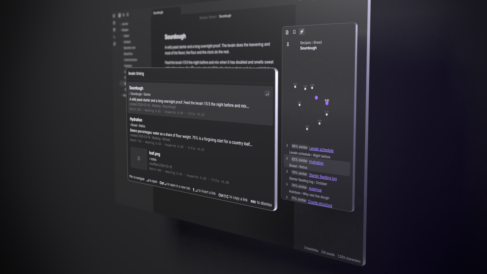

# Gnosis for Obsidian



Gnosis for Obsidian searches your vault with the retrieval pipeline of
[gnosis](https://github.com/ptsouchlos/gnosis). It reads a portable index that
you build on your own computer. It does not use a server or an API key. Your
data stays in the vault.

**Desktop only.** The models run in a worker with WebAssembly or WebGPU. Their
downloads are hundreds of megabytes, which is too much for a phone. Thus,
Obsidian does not show this plugin on mobile.

The plugin does not have its own ranking code. The gnosis query pipeline is
compiled to WebAssembly and is in `vendor/gnosis-wasm/`. Thus, the lexical
channel, the BM25+ parameters, the title bonus, the fusion weight and the vector
comparison for related notes are the same code as in the CLI. They also have the
same measurements. The plugin reads bytes from the vault, sends them to this
code and shows the results.

## What it does

**Features that need no model and no download:**

- **Search vault**: BM25+ keyword search over the text in the index. On the
  scifact benchmark, keyword search gets 0.666 nDCG@10 and the hybrid pipeline
  gets 0.722. Keyword search is less accurate than semantic search, but it
  finds most results.
- **Search scopes**: a prefix limits the search to one kind of document. Use
  `txt:` for notes, `img:` for images and `pdf:` for PDFs. For example,
  `img: red bicycle` searches only images. The prompt shows the scope. If no
  document can match the scope, the result list tells you. For example, image
  search is off, or the index has no images or PDFs. The prefixes also work in
  hybrid search. In hybrid search, the plugin queries each model only for the
  kinds of document in the scope.
- **Related notes**: the notes that are most similar to the current note. The
  quality is *full* quality, because the index already contains the vectors of
  the two notes. The list does not include the notes that the current note
  links to. Thus, the list shows unlinked mentions. A map above the list shows
  the current note at the center. The distance of a note from the center is its
  score. Notes that are similar to each other are in the same direction.
- **Show index info**: shows which tool built the index, when it was built and
  how much it contains.

**Semantic search** (Settings → Semantic search):

- **Search vault** becomes a hybrid search. The plugin embeds the query with the
  model that built your index. Then the gnosis ranking code fuses the result
  with the keyword channel. While the model loads, search uses only keywords and
  tells you.
- **Weak matches**: a result is a weak match when its meaning score is below
  the relevance floor of the model and it has no strong keyword match. Weak
  matches show after the other results, below a "Weak matches" line, in dimmed
  text. If all the results are weak, the list starts with "No strong matches".
- If a query word is not in the index, the plugin also matches it to the index
  words that are one or two typing errors away. For example, "hydraton" finds
  "hydration". These matches get half weight, thus an exact match always ranks
  first. This also works in keyword search.
- Before the plugin turns on semantic search, it asks you. It shows a list of
  the files that it downloads:
  - The model files from Hugging Face, at the revision that the gnosis CLI
    uses. bge-small-en-v1.5 is 134 MB. multilingual-e5-small is 487 MB.
  - The WebAssembly engine of ONNX Runtime, from jsDelivr. The engine for the
    CPU is 14.3 MB. The engine for a graphics card, through WebGPU, is 26.9 MB.
    To use only the CPU engine, set Settings → Compute to CPU.

  The plugin keeps these files in a cache. It does not download them again in
  the next session.
- **The plugin downloads the engine. It does not bundle it.** The engine would
  make `main.js` 14 to 41 MB larger. Obsidian reads and parses this file each
  time it starts, for each user. This includes the users who never turn on
  semantic search. The plugin downloads the engine only after you agree. It
  uses the URL of the onnxruntime-web release that the plugin was built with. A
  SHA-256 hash, set at build time, checks the file before the plugin caches it
  and each time the plugin loads it. The plugin refuses a file that does not
  match and does not run it. The download contains only the WebAssembly of the
  engine. The JavaScript of the engine is in `main.js`. The plugin does not
  download code from other locations.
- **Your data stays on your device.** The model runs locally in a worker. The
  plugin does not upload notes or queries.
- The plugin reads from the index how to embed a query: the pooling and the
  query prefix. Thus, for an index built with `query_instruction = false`, the
  plugin sends the query without the instruction, as the CLI does.

**Image search** (Settings → Search images):

- Images that the CLI indexed show in **Search vault** together with notes,
  each with a thumbnail. Select an image to open it. A text query finds images
  through the CLIP text tower (`Qdrant/clip-ViT-B-32-text`, 258 MB, the same
  files that the CLI uses). This is a second model. The plugin asks for it
  separately. It has an effect only when the open index has an image space.
- The image scores agree with the CLI scores to 2e-7, and the rank order is the
  same (`test/image-parity.test.ts`).
- *Delete model* also removes CLIP and turns off image search. The model card
  includes CLIP in its count.
- **Index images in the plugin.** When this setting is on, *Build index* also
  embeds the PNG, JPEG and WebP files in the vault with the CLIP vision tower
  (`Qdrant/clip-ViT-B-32-vision`, 352 MB). It also gives each document a
  CLIP-text title proxy. `gnosis index` writes the same data when
  `[embed.image]` is on. This one setting controls the two towers, and its
  prompt names the vision tower. The plugin downloads the vision tower only
  when a build must embed an image for the first time. An automatic update
  never downloads it. If an image file does not decode, the build skips it, as
  the CLI does. Preprocessing follows fastembed, not transformers.js: the image
  is scaled to 224x224 with a Catmull-Rom filter, and the alpha channel is
  removed. For a 16:9 photo, transformers.js gets a score of 0.69 against the
  CLI vectors. This plugin gets more than 0.9999.

**PDF indexing** (Settings → Index PDFs, off by default):

- When this setting is on, *Build index* reads the text of each PDF in the
  vault and indexes it page by page. Search then finds PDFs as it finds notes.
  Use the `pdf:` prefix to search only PDFs.
- The plugin reads PDFs with the same gnosis code as `gnosis index`. It reads
  them in a separate worker.
- A scanned PDF has no text layer, thus it has no text to index. The build
  skips it. The build also skips a PDF that it cannot read, and a PDF that
  takes more than 60 seconds to read. The diagnostics report records each
  skipped file.
- A build reads each PDF fully and embeds all its pages. Thus, a vault with
  many PDFs takes more time to build.

**Building the index here** (command: *Build index*), desktop only:

- The plugin builds the index with the gnosis `Builder`, compiled to
  WebAssembly. Parsing, chunking, content hashes and the shard layout are the
  same as in `gnosis index` and `gnosis export`. An index built from nothing on
  the kepano-obsidian vault is byte for byte the same as the CLI export, except
  for the per-chunk i8 scales. These scales differ only in their last bits
  (less than 1e-6 relative) between the two runtimes.
- **Incremental**: the build embeds only the notes whose content changed. If no
  note changed, the build writes nothing. After an edit, the build writes again
  only the shard that contains the note, and the manifest.
- **You can stop and continue a build**: the build saves its progress in
  IndexedDB on this device. It never saves progress in the vault, thus a
  partial index never syncs. If you use *Cancel index build* or close
  Obsidian, the existing index does not change. The next *Build index*
  continues from the point where the last build stopped.
- **Rebuild from scratch** (command: *Rebuild index from scratch*): the plugin
  asks you first. Then it embeds all notes again, including the notes that did
  not change. The plugin cannot update an index in an older artifact format.
  For such an index, *Build index* offers the same rebuild. An automatic update
  does not change it.
- An existing index keeps its model and its settings. For a vault with no
  index, the plugin uses *Model for new indexes* (default: bge-small-en-v1.5).
- **Two writers**: another device or the CLI can write the index in the vault.
  In that case, the plugin asks before it replaces the index. It also tells you
  what a rebuild here removes, for example images, PDFs or other folders.

**Limits:**

- The "notes changed" line on the index card counts only notes, not images. A
  build finds changes to images.

## Getting started

Install the plugin and run **Build index**. The plugin asks before it downloads
the model. Then it builds the index in the background and shows the progress
in the status bar.

You can also build the index with the gnosis CLI. On a large vault, the CLI is
faster:

```sh
cd /path/to/vault
gnosis index .
gnosis export --out .gnosis/artifact
```

The index is in `.gnosis/artifact` by default. You can change this location.
The index is a manifest and a set of shards. Shard names do not change, and a
build writes again only the documents that changed. Thus, the index syncs as a
small number of files, not as one large file.

## Building

```sh
npm install
npm run build     # writes main.js
npm test          # the suites below
script/install.sh /path/to/vault
```

No Rust toolchain needed: the WebAssembly module and its JS glue are committed
under `vendor/gnosis-wasm/`, with the gnosis revision they came from recorded
in `vendor/gnosis-wasm/GNOSIS_REV`.

A gnosis release refreshes them. Its tag publishes the wasm bundle as a release
asset and notifies this repo, and `.github/workflows/update-wasm.yml` vendors
that asset, checks it against its published SHA-256, runs the tests and opens a
`chore: Re-vendor gnosis-wasm for vX.Y.Z` pull request. The asset is used as
published, never rebuilt. The same can be done by hand:

```sh
script/update-wasm.sh --release v0.1.0   # a gnosis release; no tag means the latest
script/update-wasm.sh ../gnosis          # build from a gnosis checkout, for local work
```

`main.js` is about 1.4 MB: the inlined 666 KB gnosis `.wasm`, and the
embedding worker (transformers.js and ONNX Runtime's JavaScript, 509 KB), which
is inlined as source and started from a blob. Both are inlined because the
community-plugin channel ships only `main.js`, `manifest.json` and
`styles.css`. The only network access is the consented download above: the
plugin fetches no JavaScript at run time.

## License

[MIT](LICENSE). `main.js` also bundles transformers.js and its tokenizer and
template packages (Apache-2.0 and MIT), ONNX Runtime Web (MIT), and the gnosis
query client compiled to WebAssembly (MIT) with the Rust crates it links. Their
licenses are in [`THIRD_PARTY_NOTICES.md`](THIRD_PARTY_NOTICES.md), generated
from what the build reads by `npm run notices`.
